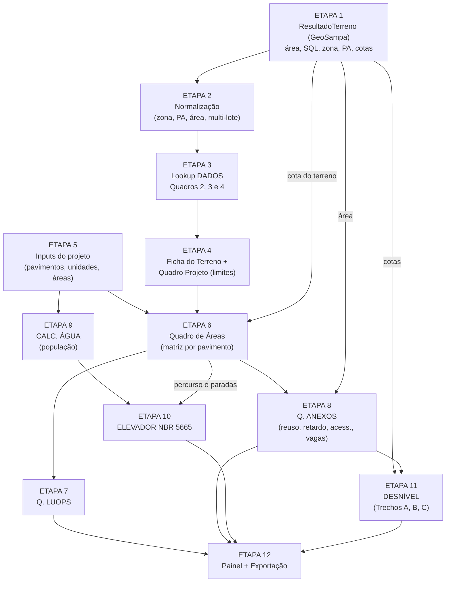

# Plano de Conexão — Dados do GeoSampa → Cálculos da Planilha `QUADRO_DE_ÁREAS-R01.xlsx`

Este documento define **passo a passo** como os dados que o software já extrai do GeoSampa
(objeto `ResultadoTerreno`) alimentam cada célula/fórmula da planilha, na ordem em que os
cálculos dependem uns dos outros.

> Base: leitura direta das 7 abas da planilha — `Q. ÁREAS`, `Q. LUOPS`, `Q. ANEXOS`,
> `CALC. ÁGUA`, `ELEVADOR`, `DADOS`, `DESNÍVEL` (endereços de célula citados entre colchetes).

### Legenda de origem do dado

| Símbolo | Origem |
|---|---|
| 🟢 **GEO** | Automático — já extraído do GeoSampa (`ResultadoTerreno`) |
| 🔵 **TAB** | Consulta à tabela legal (aba `DADOS` → Quadros 2, 3 e 4) |
| 🟡 **USR** | Entrada do usuário (projeto/arquitetura) |
| ⚪ **CALC** | Fórmula calculada pelo software |

---

## 0. Visão geral da cadeia de dependências

---

## ETAPA 1 — Dados disponíveis do GeoSampa (já implementado)

Objeto `ResultadoTerreno` gerado por `processar_terreno_completo()` em `services/spatial_analyzer.py`:

| Campo do software | Conteúdo | Usado em |
|---|---|---|
| `area_total_m2` | Área do terreno unificado (soma geométrica dos lotes selecionados) | `Q. ÁREAS!D38` e tudo que depende dele |
| `lotes[].sql_formatado` / `area_cartografica_m2` | SQL e área de cada lote unitário | Ficha do Terreno, tabela Unitário × Unificado |
| `endereco_aproximado` / `atributos_brutos.nm_logradouro` | Endereço | `Q. ÁREAS!D37`, `ELEVADOR!C17` |
| `zoneamento.sigla_zona` / `zonas_detectadas` | Zona LPUOS (ex.: `ZM`) | `Q. ÁREAS!D39` |
| `qualificacao_ambiental.valor` | Texto do perímetro (ex.: `PA 6 (...)`) | `Q. ÁREAS!D40` |
| `macrozona.valor` / `macroarea.valor` | Macrozona e macroárea | Ficha (informativo) + regra do PA 13 |
| `topografia.cota_min_m` / `cota_max_m` / `desnivel_m` | Cotas das curvas de nível | `Q. ÁREAS!A5`, `DESNÍVEL!G5/C48` |
| `testada_principal_m` / `profundidade_estimada_m` | Dimensões estimadas | Pré-dimensionamento da projeção e trechos hidráulicos |
| `tombamento_detectado` | Patrimônio | Checklist / alerta |

---

## ETAPA 2 — Normalização dos dados GeoSampa (novo: `services/viabilidade_bridge.py`)

A planilha procura a zona e o PA com `VLOOKUP` exato. Os textos da aba `DADOS` contêm espaço
não separável (`PA\xa06`) e sufixos de nota (`ZEUP (a)`, `PA 13 (e)`, `28 (c)`). Portanto:

1. **Zona** → `normalizar_zona("ZEUP (a)") = "ZEUP"`
   - Remove `\xa0`, notas entre parênteses e espaços; caixa alta preservando sufixo minúsculo `a` (`ZEUa`, `ZMa`).
2. **PA** → `extrair_pa("PA 6 (Perímetro de Qualificação Ambiental 6 ...)") = "PA 6"` (regex `PA\s*(\d{1,2})`).
3. **Área usada nos cálculos** → `area_calculo = area_total_m2 − area_doacao` 🟡
   (planilha: `Q. LUOPS!A2` "Área do terreno E = R", com nota para doação).
4. **Multi-lote** → se os lotes selecionados tiverem zonas diferentes, exibir alerta e pedir ao usuário a zona predominante 🟡 (a planilha só aceita uma zona em `D39`).
5. **Número tratado** → valores `"NA"` e `"28 (c)"` viram `None` e `28.0` + nota `c`.

**Saída:** `EntradaGeo(area_terreno, endereco, sqls, zona, pa, cota_terreno, macroarea, alertas)`.

---

## ETAPA 3 — Consulta às tabelas legais (aba `DADOS`)

Transcrever a aba `DADOS` para `domain/tabelas_dados.py` (dicionários Python), mantendo exatamente as
colunas que a planilha consulta:

| Tabela | Colunas na planilha | Campos no software |
|---|---|---|
| **Quadro 2** (Decreto HIS) | `DADOS!C:N` → C zona · D CA mín · E CA básico · F CA máx EHIS · G CA máx EHMP · H TO ≤500 · I TO >500 · J gabarito · K recuo frente · L/M recuos · N cota-parte | `QUADRO_2[zona]` |
| **Quadro 3** (LPUOS 16.402) | `DADOS!AE:AO` → AF CA mín · AG básico · AH CA máx · AI TO ≤500 · AJ TO ≥500 · AK gabarito · AL frente · AM/AN recuos · AO cota-parte | `QUADRO_3[zona]` |
| **Quadro 4** (Permeabilidade) | `DADOS!P:R` → P perímetro · Q lote ≤500 · R lote >500 | `QUADRO_4[pa]` |
| Listas | `DADOS!U:V` sistema estrutural · `DADOS!X` tipo de escada | listas de seleção |

### Fórmulas de lookup (exatamente como na planilha)

| Célula | Significado | Fórmula na planilha | Implementação |
|---|---|---|---|
| `C43` | T.O. máxima | `IF(D38<500, Q2.H, Q2.I)` | `to = q2.to_ate_500 if area < 500 else q2.to_acima_500` |
| `C44` | C.A. básico | `Q2.E` | `q2.ca_basico` |
| `C45` | C.A. máximo (LPUOS) | `Q3.AH` | `q3.ca_maximo` |
| `C46` | C.A. Decreto HIS | `Q2.F` | `q2.ca_max_ehis` |
| `W40` | C.A. majorado (+20%) | `W39 × 1,2` | `ca_majorado = ca_his × 1.2` |
| `C47` | Permeabilidade mín. | `IF(D38>500, Q4.R, Q4.Q)` | `tp = q4.acima_500 if area > 500 else q4.ate_500` |
| `C51` | Gabarito máximo | `Q2.J` | `q2.gabarito_m` |
| `Q. LUOPS!E22` | Cota-parte Q | (digitado 20) | `q2.cota_parte` (20 em ZEU/ZEM, 40 em ZEUa/ZEMP, `None` nas demais) |
| `W41` / `T49` | Fachada ativa | `W36 × 0,5` | `0,5` se zona ∈ {ZEU, ZEUa, ZEM, ZEMP, ZC} senão `0,2` (nota em `Q. LUOPS!G20`) |

> ⚠️ Atenção ao limite de 500 m²: a T.O. usa `< 500` e a permeabilidade usa `> 500`.
> Um terreno com exatamente 500 m² pega T.O. "superior" e TP "até 500". O software replica isso
> e mostra uma nota explicativa.

**Regras extras:**
- Se `PA 13` (Macroáreas de Contenção/Preservação, vindo de `macroarea` do GeoSampa) → TP = `NA`.
- Se zona `ZCOR*` → TP = 0,30 independente do lote (nota (a) do Quadro 4).
- Notas (e), (f), (g) do Quadro 2: CA máx = 2 (ou 1) quando lote ≤ 1.000 m² / ≤ 500 m² em ZEIS → aplicar automaticamente com base em `area_terreno`.

**Teste de referência (valores da planilha atual):** zona `ZM`, `PA 6`, terreno < 500 m² →
`TO 0,85 · CA bás. 1 · CA máx 2 · CA HIS 3 · CA +20% 3,6 · TP 0,15 · gabarito 28 m`.

---

## ETAPA 4 — Ficha do Terreno e Quadro Projeto (limites legais)

### 4.1 Ficha do Terreno (`Q. ÁREAS!B35:F66`)

| Célula | Campo | Origem |
|---|---|---|
| `D36` | Empreendimento | 🟡 |
| `D37` | Endereço | 🟢 `endereco_aproximado` |
| `D38` | Área do terreno (m²) | 🟢 `area_calculo` |
| `D39` | Zona | 🟢 `zona` normalizada (editável) |
| `D40` | Qualificação ambiental | 🟢 `pa` |
| `C43:C51` | Índices exigidos por lei | 🔵 Etapa 3 |
| `D43` = `C43×D38` | Área de ocupação máxima | ⚪ |
| `D44` = `C44×D38` | Área computável básica | ⚪ |
| `D45` = `C45×D38` | Área computável máxima LPUOS | ⚪ |
| `D46` = `C46×D38` | Área computável máxima HIS | ⚪ |
| `D47` = `C47×D38` | Área permeável mínima | ⚪ |
| `D52:D56` | Sistema construtivo, torres, pavimentos, elevadores/torre, tipo de escada | 🟡 (listas da aba `DADOS`) |

### 4.2 Quadro Projeto (`Q. ÁREAS!S35:W54`)

| Célula | Campo | Fórmula |
|---|---|---|
| `W36` | Área terreno | `= D38` 🟢 |
| `W37` | Terraço / pav. | `= W36 × 0,05` |
| `W38` | C.A. zoneamento | hoje digitado (2,5) → **passa a ser seleção** entre `C45`, `W39` ou `W40` conforme modalidade 🟡 |
| `W39` | C.A. decreto HIS | `= C46` |
| `W40` | C.A. +20% | `= W39 × 1,2` |
| `W41` | Fachada ativa | `= W36 × 0,5` (ou 0,2) |
| `W42` | Pavimentos | 🟡 |
| `W43` | Perm. mín. QA | `= C47` |

### 4.3 Balanço "Área Máx. × Projeto × Sobra" (`T46:W54`)

| Linha | Área máxima (T) | Projeto (U) | Sobra |
|---|---|---|---|
| Computável | `W38 × W36` | `L25+M25+O25+P25+Q25` | `T − U` |
| HIS-2 (cota) | `U46 × 0,10` | `Y25` | `T − U` |
| NR1-12 | `L25 × 0,20` | `AB25` | `T − U` |
| NR1-3 (F.A.) | `W36 × 0,5` | `AD25` | `T − U` |
| R2V-1 (10%) | `U46 × 0,10` | `AA25` | `T − U` |
| Terraço | `W37 × W42` | `S25 + P25` | `T − U` |
| Permeável | `W36 × W43` | 🟡 implantação | `U − T` |
| E.C.C. | `(D25+E25+G25+H25) × 0,5` | `T25` | `U − T` |
| Lazer desc. | `(D25+E25+G25) × 2` | 🟡 | `U − T` |

Semáforo no painel: **verde** se dentro do limite, **vermelho** se excedido.

---

## ETAPA 5 — Entradas do projeto (o que o usuário precisa informar)

Formulário em `ui/quadro_areas_ui.py` com valores pré-sugeridos a partir do GeoSampa:

1. **Pavimentos** 🟡: lista de níveis (subsolos, térreo, 1º…Nº, ático) e pé-direito de cada um
   (planilha usa 2,85 / 3,50 / 2,72 / 2,92 / 2,30 m).
2. **Mix de unidades** 🟡 (`Q. ÁREAS!T70:X81` e `B57:F61`): categoria (HIS-1, HIS-2, R2V-1, NR1-12, NR1-3),
   tipologia (Studio, 1 Dorm, 1 Dorm + Office, 2 Dorm), área e quantidade; preço/m².
3. **Unidades e áreas por pavimento** 🟡: preenche as colunas `D:K` (unidades) e `L:AD` (áreas).
   - Atalho: "repetir pavimento tipo" do 1º ao Nº pavimento.
4. **Modalidade** 🟡: LPUOS ordinário / EHIS / EHMP / EZEIS (define `W38` e a regra 80/20 ou 60/40).
5. **Checklist** 🟡 (`B68:F82`): Planialtimétrico, Sondagem, COMAR, Cota hidrológica, Laudo hidrológico,
   Árvore no lote/calçada, Poste, Bueiro, Contaminação, Melhoramento, Diretriz hidráulica, DIS/DUP, APP.
   - Pré-marcação automática: `tombamento_detectado` → alerta; `desnivel_m > 2 m` → sinaliza planialtimétrico.

---

## ETAPA 6 — Quadro de Áreas por pavimento (`Q. ÁREAS!A3:AF33`)

1. **Cota de nível (coluna A)**
   - `A5` (térreo) = 🟢 cota do terreno do GeoSampa (proposta: média entre `cota_min_m` e `cota_max_m`, editável).
   - `A(n+1) = A(n) + pé-direito(n)`.
2. **Por pavimento**
   - `C = D + F + G + K` (total de unidades: HIS-2 + R2V-1 + HIS-2 cota + NR1-3)
   - `AE = SOMA(L:AD)` (total do pavimento)
   - `AF = R / AE` (% circulação não computável, com proteção contra divisão por zero)
3. **Totais**
   - Linha 25 `SUBTOTAL` = soma de cada coluna nas linhas 5–24.
   - `L26 = L25+M25+N25+O25+P25+Q25` (computável total)
   - `R26 = SOMA(R25:AD25)` (não computável total)
   - `C27 = L26 + R26` (área construída total)
4. **Percentual EHIS (`L28`, `O28`)** — `HIS = L25/(L25+M25+O25)` e `R2V = O25/(L25+M25+O25)`;
   validar ≥ 80% / ≤ 20% (ou 60/40 em EZEIS).
5. **Área privativa (linha 31)** e **eficiência** `E66 = (E63 + E64) / E62`.
6. **Verificação cruzada** `AE32`: soma das linhas = soma das colunas (deve dar 0).
7. **Gabarito** `E51 = MAX(cota pavimentos) − cota térreo` comparado com `C51` 🔵.

---

## ETAPA 7 — Quadro de Uso e Ocupação do Solo (`Q. LUOPS`)

Totalmente derivado das etapas 3, 4 e 6:

| Bloco | Fórmulas |
|---|---|
| Área do terreno | `E2 = D38` 🟢 |
| Ocupação | Máx. `E3 = C43`, área `E5 = E2×E3`; utilizada `E6 = AE5` (térreo), taxa `E4 = E6/E2` |
| Permeabilidade | Exigida `E7 = C47`, área `E9 = T52`; utilizada `E10 = U52`, taxa `E8 = U52/D38` |
| C.A. | `E11 = C44` · `E12 = C45` · `E13 = W40` · utilizado `E14 = E16/E2` |
| Áreas | Comp. máx. `E15 = T46` · utilizada `E16 = L26` · Não comp. máx. `E17 = E19 × 0,59` · utilizada `E18 = R26` · Total `E19 = C27` |
| Fachada ativa | Permitida `E20 = T49` · projetada `E21 = AD25` |
| Cota-parte | `E23 = (E14 × E2)/(E13 × E22)` · `E24 = ARRED.ACIMA(E23)` — **mostrar só se zona tiver cota-parte** |
| Nº de unidades | HIS-2 `D32+G32` · R2V-1 `F32+I32` · HIS-1 `E32+H32` · NR1-12 `J32` · NR1-3 `K32` |
| E.C.C. / Lazer | `E31 = T53`, `E33 = T54` |
| E.C.C. fora do térreo | Máx. `3,00 m² × nº de unidades residenciais` (hoje digitado 360 → **calcular**) |

---

## ETAPA 8 — Anexos (`Q. ANEXOS`)

| Bloco | Fórmula | Origem do dado |
|---|---|---|
| **Reuso** | `Vri = 16 × Aci`; `Vrv = 6,3 × Acv`; `Vrm = Vri + Vrv`; projetado = `ARRED.ACIMA(Vrm/1000)×1000` | `Aci` = área de cobertura 🟡 (sugestão: projeção da torre `F43`) |
| **Retardo** | `V = Área terreno × 6,3` L; projetado arredondado p/ múltiplo de 5.000 L | 🟢 **direto do GeoSampa** (`area_calculo`) |
| **Acessibilidade** (Art. 14 Dec. 63.728/24) | HIS-2, R2V-1 e HIS-1: `ARRED.ACIMA(total × 3%)`; NR1-12: `5%` | ⚪ da Etapa 6 |
| **Tipologias** | `Total coberta = Computável + TE` | 🟡 |
| **Vagas** | PNE/utilitário `1 / 4.000 m²`; idoso e motos `5% × automóveis` | ⚪ |
| **Uso incentivado** (Art. 1º III e 18 IV) | HIS-2 permitido `T46 × 0,8`; R2V-1 `T46 × 0,2`; projetados `L25`, `O25` | ⚪ |

---

## ETAPA 9 — População e água potável (`CALC. ÁGUA`)

1. Por pavimento: unidades 1D / 2D / 3D 🟡 (derivadas do mix da Etapa 5).
2. População:
   - Elevador e água: `1D×2 + 2D×4 + 3D×5`
   - Bombeiros: `1D×4 + 2D×6 + 3D×8`
3. Consumo: `L4 = População × per capita` — planilha usa 75 L; nota `L35` pede **125 L/per capita** → parâmetro configurável (padrão 125).
4. Reservatório superior recomendado `M10 = 0,4 × L4 + L7` (L7 = reserva de incêndio, hoje 25.000 L 🟡).
5. Reservatório inferior recomendado `M13 = 0,6 × L4`; total `M16 = M10 + M13`.

---

## ETAPA 10 — Tráfego de elevadores (`ELEVADOR`, NBR 5665)

| Entrada | Origem |
|---|---|
| `D26` População do prédio | ⚪ `CALC. ÁGUA!E15` |
| `E27` % a transportar em 5 min | 🔵 destinação (`O11`: Apartamentos = 10%) |
| `D34` Nº de paradas | ⚪ nº de pavimentos atendidos (Etapa 6) |
| `D36` Percurso (m) | ⚪ **cota do último pavimento − cota do pavimento mais baixo** (Etapa 6, ancorada na cota do GeoSampa) |
| `D31`, `D32/D33`, `D37`, `D38`, `D39` | 🟡 nº de elevadores, capacidade, velocidade, tipo e abertura da porta |

Fórmulas (exatamente como na planilha):

- Paradas prováveis: `Np = N − (N−1) × ((N−2)/(N−1))^P`
- Acel./retard. `ta`: `≤0,75 → 2,5` · `≤1 → 3+(V−1)×2` · `≤1,25 → 3` · `≤2,75 → 4,5+(V−2)×2` · `>2,75 → 6`
- Abertura/fechamento: AC 3,9 s · AL 5,5 s · EV 6,0 s · Entrada/saída: 2,4 s
- `T1 = 2H/V` · `T2 = ta × Np / 2` · `T3 = t_porta × Np` · `T4 = 2,4 × P`
- `TTV = T1+T2+T3+T4 + 0,10×(T3+T4)`
- Intervalo `= TTV / nº elevadores` · Capacidade de transporte `= 300 × P / TTV` · Capacidade de tráfego `= nº elev. × CT`
- Validação: `Capac. tráfego ≥ população 5 min` e intervalo ≤ máximo (não se aplica a apartamentos)
- Distância mínima p/ velocidade nominal: `V × (V/0,9 + 0,9/1,5)`

---

## ETAPA 11 — Desnível dos reservatórios (`DESNÍVEL`)

| Entrada | Origem |
|---|---|
| Cota do terreno (arquitetura) `G5`/`C48` | 🟢 cota GeoSampa (cota no alinhamento frontal; editável) |
| Cota da sarjeta `G4`/`C47` | 🟡 levantamento (sugestão inicial: menor cota do GeoSampa na testada) |
| Comprimentos trechos A/B/C `C4`, `C6`, `C8` | 🟡 (sugestão: `profundidade_estimada_m` para A/B e recuo + calçada para C) |

Cálculos:
- **Trecho A (Reuso):** `NA imaginado = tampa − 0,40`; `ΔH = i × (L × 1,3) × 10`; tampa real = `NA + ΔH + laje 0,12 + interf. 0,20 + Ø 0,10`.
- **Trecho B (Retardo):** saída dos ralos = `tampa reuso − ΔH(L×1,2) − 0,12 − 0,20 − 0,10`; cota mais restritiva (ralo × reuso); `NA = restritiva − 0,10`.
- **Trecho C (Sarjeta):** `ΔH = L × i × 10`; cota hidráulica = `sarjeta + ΔH + (NA reuso − NA retardo) + (tampa − NA)`.
- **Resultado:** `SE(cota arquitetura > cota hidráulica; "COTA DO TERRENO ADEQUADA"; diferença a compensar)`.

> As células da aba `DESNÍVEL` hoje apontam para um arquivo externo (`'[1]Reservatório de Retardo'`, `'[1]Memória de Cálculo'`)
> que não existe no arquivo enviado. No software esses dados passam a vir das Etapas 8 e 11 (sem vínculo externo).

---

## ETAPA 12 — Painel e exportação

1. Nova página/aba **"Estudo de Viabilidade"** no Streamlit, na ordem das etapas acima.
2. Recalcular tudo automaticamente sempre que o terreno mudar (clicar em outro lote, adicionar ou remover lotes).
3. Exportar `.xlsx` com as mesmas abas e posições de célula da planilha original (biblioteca `openpyxl`, ainda não instalada) + JSON.

---

## Inconsistências encontradas na planilha original (decidir antes de implementar)

| # | Local | Problema | Proposta no software |
|---|---|---|---|
| 1 | `Q. ÁREAS!E51`, `Q. ANEXOS!B55, B56, D56, E55` | `#REF!` (referência apagada) | Recalcular gabarito e uso incentivado pelas Etapas 6 e 8 |
| 2 | `Q. ÁREAS!W38` | C.A. digitado (2,5), não vem da zona | Seleção: LPUOS (`C45`) / HIS (`W39`) / +20% (`W40`) |
| 3 | `Q. ÁREAS!E25`, `R25`, `N25` | Somas que pulam linhas (`E7:E24`, `R7:R23`, `N5:N23`) | Somar todos os pavimentos |
| 4 | `Q. ÁREAS!AE5:AE7` × `AE8` | Total do pavimento ora `L:Y`, ora `L:AD` | Padronizar `L:AD` |
| 5 | `Q. ANEXOS!D24` | Texto diz 5% (NR1-12), fórmula usa 3% | Usar 5% |
| 6 | `Q. ANEXOS!D3` | Cobertura impermeável = área do 2º pavimento (`AE7`) | Campo próprio "área de cobertura" |
| 7 | `Q. LUOPS!E38` | E.C.C. máx. digitado (360) | `3 × nº unidades residenciais` |
| 8 | `CALC. ÁGUA!L4` | Usa 75 L/hab., nota pede 125 | Parâmetro com padrão 125 |
| 9 | `DESNÍVEL` | Vínculos com arquivo externo inexistente | Dados internos do software |
| 10 | `Q. ÁREAS!C43` × `C47` | `< 500` na T.O. e `> 500` na TP | Replicar e documentar |

---

## Arquivos a criar/alterar

| Arquivo | Conteúdo |
|---|---|
| `domain/tabelas_dados.py` | Quadros 2, 3 e 4 transcritos da aba `DADOS` |
| `domain/viabilidade_models.py` | Dataclasses `EntradaGeo`, `IndicesLegais`, `Pavimento`, `QuadroAreas`, `QuadroLUOPS`, `Anexos`, `CalcAgua`, `Elevador`, `Desnivel` |
| `services/viabilidade_bridge.py` | Etapas 1–4: `ResultadoTerreno → EntradaGeo → IndicesLegais` |
| `services/quadro_areas_engine.py` | Etapas 6–8 |
| `services/agua_elevador_engine.py` | Etapas 9–10 |
| `services/desnivel_engine.py` | Etapa 11 |
| `ui/viabilidade_ui.py` | Telas das etapas 4–12 |
| `tests/test_viabilidade_bridge.py` | Casos de referência da planilha (ZM / PA 6 / < 500 m²) e de cada fórmula |

## Ordem de implementação sugerida

1. Etapas 2 e 3 (normalização + tabelas `DADOS`) com testes → base de tudo.
2. Etapa 4 (Ficha e Quadro Projeto) já conectada ao mapa: clicar no lote preenche índices e limites.
3. Etapas 5 e 6 (inputs e matriz por pavimento).
4. Etapas 7 e 8 (LUOPS e anexos).
5. Etapas 9 e 10 (água e elevador).
6. Etapa 11 (desnível) e Etapa 12 (exportação `.xlsx`).

