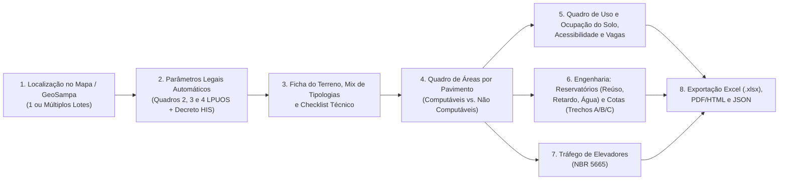

# Plano de Arquitetura e Implementação — Sistema Completo de Estudo de Viabilidade (Planilha Yonder + GeoSampa)

Este documento detalha o planejamento técnico para implementar, dentro do software de Estudo de Viabilidade integrado ao **GeoSampa**, todas as tabelas, fórmulas, travas legais e dimensionamentos de engenharia presentes na planilha de viabilidade da **Yonder**.

---

## 1. Visão Geral da Integração (GeoSampa → Planilha de Viabilidade)

O objetivo é unir a **captura espacial automatizada do terreno** (que já consulta SQL, polígono, topografia, Zona, Macrozona, Macroárea e Perímetro de Qualificação Ambiental no GeoSampa) com o **motor completo de cálculo arquitetônico, legal e de engenharia** da planilha:



---

## 2. Mapeamento Completo dos Módulos da Planilha

### Módulo 1 — Motor de Regras Urbanísticas: Quadros 2, 3 e 4 (LPUOS + PDE + Decreto HIS)
**Arquivo alvo:** `domain/zoning_rules.py` e novo `domain/legislation_tables.py`

1. **Quadro 3 (LPUOS — Lei nº 16.402/2016) vs. Quadro 2 (Decreto HIS nº 63.728/2024, 57.377/16 e 59.885/20):**
   - **Zonas suportadas:** `ZEU`, `ZEUa`, `ZEUP`, `ZEUPa`, `ZEM`, `ZEMP`, `ZC`, `ZCa`, `ZC-ZEIS`, `ZCOR-1`, `ZCOR-2`, `ZCOR-3`, `ZCORa`, `ZM`, `ZMa`, `ZMIS`, `ZMISa`, `ZEIS-1`, `ZEIS-2`, `ZEIS-3`, `ZEIS-4`, `ZEIS-5`, `ZDE-1`, `ZDE-2`, `ZPI-1`, `ZPI-2`, `ZPR`, `ZER-1`, `ZER-2`, `ZERa`, `ZPDS`, `ZPDSr`, `ZEPAM`, `AVP-1`, `AVP-2`, `AI`, `AIa`, `AC-1`, `AC-2`.
   - **Coeficientes de Aproveitamento (C.A.):**
     - `C.A. Mínimo` e `C.A. Básico`
     - `C.A. Máximo Ordinário (Quadro 3 LPUOS)`
     - `C.A. Máximo EHIS (Quadro 2 Decreto HIS)` e `C.A. Máximo EHMP`
     - `C.A. Majorado (Cota de Solidariedade +20% — PDE Art. 112 §8º)` (ex.: em `ZM`, `CA_HIS = 3,0` e `CA_Cota+20% = 3,6`; em `ZEU`, `CA_HIS = 6,0`).
   - **Taxa de Ocupação (T.O.) escalonada pela área do terreno:**
     - `Lote ≤ 500 m²` (ex.: `0,85` em `ZEU`, `ZM`, `ZC`, `ZEM`)
     - `Lote > 500 m²` (ex.: `0,70` em `ZEU`, `ZM`, `ZC`, `ZEM`)
   - **Cota-Parte Máxima de Terreno por Unidade (`Q` — Art. 79 da Lei 16.050/14):**
     - `20 m²` em `ZEU` e `ZEM`; `40 m²` em `ZEUa` e `ZEMP`; `NA` nas demais zonas.
     - Fórmula automática do número mínimo de unidades:
       $$N_{\min} = \left\lceil \frac{CA_{\text{utilizado}} \times A_{\text{terreno}}}{CA_{\max} \times Q} \right\rceil$$
   - **Notas Legais Automáticas (`a` a `m`):** alertas dinâmicos conforme área do lote (ex.: lotes $\le 1.000\text{ m}^2$ ou $\le 500\text{ m}^2$ em ZEIS/ZEM/ZEMP) e dispensa de gabarito/recuos (art. 8º e art. 66/67/69 da LPUOS e art. 13 do Decreto HIS).

2. **Quadro 4 — Taxa de Permeabilidade Mínima por Perímetro de Qualificação Ambiental (`PA 1` a `PA 13`):**
   - Preenchimento automático a partir do `PA` detectado na consulta pelo ponto geográfico no GeoSampa:
     - `PA 1` a `PA 5`: `0,15` ($\le 500\text{ m}^2$) | `0,25` ($> 500\text{ m}^2$)
     - `PA 6` a `PA 8`: `0,15` ($\le 500\text{ m}^2$) | `0,20` ($> 500\text{ m}^2$)
     - `PA 9`: `0,10` ($\le 500\text{ m}^2$) | `0,15` ($> 500\text{ m}^2$)
     - `PA 10`: `0,20` ($\le 500\text{ m}^2$) | `0,25` ($> 500\text{ m}^2$)
     - `PA 11` e `PA 12`: `0,20` ($\le 500\text{ m}^2$) | `0,30` ($> 500\text{ m}^2$)
     - `PA 13`: `NA` (Macroáreas de Contenção Urbana e Preservação)
   - **Trava Legal — Nota (b) do Quadro 4:** se $TO_{\max} + TP_{\min} > 1,00$, a Taxa de Permeabilidade é preservada e a Taxa de Ocupação máxima é reduzida para $1,00 - TP_{\min}$.

---

### Módulo 2 — Ficha do Terreno, Ficha do Empreendimento, Tipologias e Checklist Técnico
**Arquivo alvo:** `domain/project_models.py` e `ui/ficha_empreendimento.py`

1. **Ficha do Terreno & Quadro Projeto:**
   - Dados integrados automaticamente do GeoSampa: `Endereço`, `SQL(s)`, `Área do Terreno (m²)` (com campo para **Doação de Calçada / Melhoramento Viário** e cálculo da **Área Remanescente** $E - D = R$), `Zona`, `Qualificação Ambiental (PA)`.
   - Definições construtivas selecionáveis:
     - **Modalidade de enquadramento:** `LPUOS Ordinário`, `EHIS (Decreto 63.728/24)`, `EHMP`, `EZEIS (ZEIS-5 60/40)`.
     - **Sistema Construtivo:** `Alvenaria Estrutural 14cm (T+22)`, `Alvenaria Estrutural 19cm (>T+22)`, `Parede de Concreto (22<T<29)`, `Concreto Armado Convencional`.
     - **Tipo de Escada:** `Não Enclausurada`, `Enclausurada Protegida`, `À Prova de Fumaça`, `À Prova de Fumaça Pressurizada`.
     - **Configuração de Torres e Pavimentos:** Nº de Torres, Subsolos/Inferiores, Térreo, Pavimentos Tipo e Ático (ex.: `2 INF + T + 9 PAV`), Nº de Elevadores por Torre.

2. **Mix de Unidades, Tipologias e Preço/m² (VGV Preliminar):**
   - **Tabela de Tipologias (01 a 11):** `Área Computável (m²)`, `Área Não Computável / Terraço TE (m²)` e `Área Total Coberta (m²)`.
   - **Distribuição por Categoria e Dormitórios:**
     - Categorias: `HIS-1`, `HIS-2`, `R2V-1`, `NR1-12 (Não Residencial)` e `NR1-3 (Loja / Fachada Ativa)`.
     - Tipologias: `Studio (~18 a 24,57 m²)`, `1 Dorm (~24,47 a 25 m²)`, `1 Dorm + Office (~27,00 m²)`, `2 Dorm (~28 a 45 m²)`, `3 Dorm`.
     - Preço de venda por m² (`R$/m²`) por faixa de unidade e cálculo automático de **Área Privativa Total**, **Eficiência ($\text{Área Privativa} / \text{Área Construída Total}$)** e **VGV Estimado (R$)**.

3. **Checklist de Viabilidade e Restrições Físicas/Legais (`SIM`, `NÃO`, `N/A`, `OBS`):**
   - `Planialtimétrico`, `Sondagem`, `COMAR`, `Cota Hidrológica`, `Laudo Hidrológico`, `Árvore no Lote`, `Árvore na Calçada`, `Poste na Frente`, `Bueiro na Frente`, `Contaminação`, `Melhoramento Viário`, `Diretriz Hidráulica`, `DIS/DUP`, `APP`.

---

### Módulo 3 — Quadro de Áreas Pavimento a Pavimento (Matriz Completa)
**Arquivo alvo:** `services/area_schedule_engine.py` e `ui/quadro_areas_ui.py`

1. **Estrutura de Linhas (Pavimentos):**
   - Geração dinâmica de pavimentos (`Subsolos / Inferiores`, `Térreo`, `1º ao Nº Pavimento`, `Ático`) com cálculo automático da **Cota de Nível (m)** a partir da cota altimétrica do terreno no GeoSampa + pé-direito configurável de cada nível (ex.: `784,40` no Térreo → `787,25` no 1º Pav → `837,32` no Ático).

2. **Estrutura de Colunas por Pavimento:**
   - **Unidades (9 colunas):** `TOTAL`, `HIS-2`, `HIS-1`, `R2V-1`, `HIS-2 (Cota)`, `HIS-1 (50%)`, `R2V-1 (10%)`, `NR1-12`, `NR1-3 (F.A.)`.
   - **Áreas Computáveis (6 colunas):** `HIS-2`, `HIS-1`, `Terraço HIS-2`, `R2V-1`, `Terraço R2V-1`, `Circulação Computável`.
   - **Áreas Não Computáveis (13 colunas):** `Circulação Não Comp.`, `Terraço`, `E.C.C.`, `N.C.C.`, `Estacionamento`, `O.C.`, `A.T.`, `HIS-2 (Cota Solidariedade)`, `HIS-1 (50%)`, `R2V-1 (10% incentivo)`, `NR1-12`, `Circ. + Terraço NR1-12`, `NR1-3 (Fachada Ativa)`.
   - **Indicadores por Pavimento:** `TOTAL DO PAVIMENTO (m²)` e `% CIRC. Ñ COMP. / PAV.`.

3. **Totalizadores, Verificação Cruzada e Balanço de Áreas (`ÁREA MÁX.` vs. `PROJETO` vs. `SOBRA`):**
   - Linhas automáticas de `SUBTOTAL`, `TOTAL GERAL`, `ÁREA PRIVATIVA` e **Verificação de Fechamento (`Soma Linhas − Soma Colunas = 0`)**.
   - **Percentual dos Usos Computáveis EHIS (Art. 1º e Art. 18 do Decreto nº 63.728/2024):**
     - Verificação automática de `80% HIS / 20% R2V` (ou `60% / 40%` quando `EZEIS / ZEIS-5`).
   - **Quadro de Controle de Limites Legais (`Área Máxima Permitida` × `Área Projetada` × `Sobra / Excesso`):**
     - `Computável Ordinário (CA Básico / Máximo)`
     - `HIS-2 (Cota de Solidariedade — PDE Art. 112 §8º)`
     - `NR1-12` e `NR1-3 (Fachada Ativa — Decreto HIS Art. 13: até 50% da área do lote em ZEU/ZEM/ZEMP/ZC ou 20% nas demais)`
     - `R2V-1 (10% incentivo)`
     - `Terraço Não Computável (LPUOS Art. 62 — limite de 15% da área do pavimento)`
     - `Área Permeável (LPUOS Art. 81 / Quadro 4)`
     - `E.C.C. (Decreto HIS Art. 18 e COE Art. 108 — máx. 3,00 m²/unidade fora do térreo)`
     - `Lazer Descoberto (2,00 m²/unid. HIS)` e `Espaço Coberto Comum (0,50 m²/unid. HIS)`.

---

### Módulo 4 — Quadro de Uso e Ocupação do Solo, Acessibilidade e Vagas
**Arquivo alvo:** `services/urban_compliance_engine.py`

1. **Quadro Oficial de Uso e Ocupação do Solo (Padrão Prefeitura de São Paulo):**
   - Área do Terreno (Escritura, Doação e Remanescente).
   - Ocupação e Permeabilidade (`Taxa Máxima/Exigida` vs. `Taxa Utilizada`; `Área Máxima/Exigida` vs. `Área Utilizada`).
   - Coeficiente de Aproveitamento (`Básico`, `Máximo`, `Majorado` e `Utilizado`).
   - Áreas (`Computável Máxima/Utilizada`, `Não Computável Máxima/Utilizada`, `Construída Total`).
   - Fachada Ativa (`Permitida` vs. `Projetada`), Cota-Parte (`Q`, `N mínimo`), Número de Unidades por categoria (`HIS-2`, `R2V-1`, `HIS-1`, `NR1-12`, `NR1-3`), `E.C.C.` e `Lazer Descoberto`.

2. **Quadro Demonstrativo de Acessibilidade (Art. 14 do Decreto nº 63.728/2024):**
   - `HIS-2`: `3%` adaptáveis ($\lceil 0,03 \times \text{Total UH}_{\text{HIS-2}} \rceil$).
   - `R2V-1`: `3%` adaptáveis ($\lceil 0,03 \times \text{Total UH}_{\text{R2V-1}} \rceil$).
   - `HIS-1`: `3%` adaptáveis (arredondado para cima, respeitando mínimo de 1 por pavimento quando aplicável).
   - `NR1-12`: `5%` de unidades adaptadas ($\lceil 0,05 \times \text{Total}_{\text{NR1-12}} \rceil$).

3. **Quadro de Vagas de Estacionamento:**
   - Cálculo automático de vagas exigidas e projetadas (`Cobertas` e `Descobertas`) para:
     - `P.N.E. / Utilitários` ($\lceil \text{Área Computável} / 4.000\text{ m}^2 \rceil$)
     - `Livres (Automóveis)`
     - `Idoso` ($5\% \times \text{Automóveis}$)
     - `Motos` ($5\% \times \text{Automóveis}$).

---

### Módulo 5 — Dimensionamento Hidráulico: Reservatórios (Reúso, Retardo, Água Potável) e Cotas (Trechos A, B e C)
**Arquivo alvo:** `services/hydraulics_engine.py`

1. **Reservatório de Reúso (Aproveitamento de Águas Pluviais das Coberturas):**
   - Cobertura impermeável ($A_{ci}$):
     $$V_{ri} = 16,00 \times A_{ci} \text{ (litros)}$$
   - Cobertura verde ($A_{cv}$):
     $$V_{rv} = 6,30 \times A_{cv} \text{ (ou } 5,40 \times A_{cv}\text{, selecionável)}$$
   - Volume exigido $V_{rm} = V_{ri} + V_{rv}$ e Volume Projetado arredondado para cima em módulos comerciais (`10.000 L`, `15.000 L`, `20.000 L`...).

2. **Reservatório de Retardo (Controle de Escoamento Superficial):**
   - Volume exigido:
     $$V_{\text{retardo}} = A_{\text{terreno}} \times 6,30 \text{ (litros)}$$
   - Volume Projetado arredondado para cima em múltiplos de `5.000 L`.

3. **População por Pavimento e Reservatório de Água Potável:**
   - Cálculo da população por pavimento (`1 Dorm` = 2 hab., `2 Dorm` = 4 hab., `3 Dorm` = 5 hab.) para **Elevador**, **Água** e **Bombeiros**.
   - Consumo diário estimado:
     $$C_{\text{dia}} = \text{População Total} \times 125\text{ L/dia} \quad (\text{ajustável entre } 75\text{ e } 125\text{ L/per capita})$$
   - Divisão entre Reservatório Superior e Reservatório Inferior (Recomendado vs. Projetado).

4. **Cálculo de Cota de Desnível dos Reservatórios e Deságue na Sarjeta (Trechos A, B e C):**
   - **Trecho A (Final do terreno até o Reservatório de Reúso):**
     - Comprimento do trecho ($L_A$), inclinação da tubulação de águas pluviais ($i = 0,0005$), espessura da laje ($0,12\text{ m}$), interferência de tubulações ($0,20\text{ m}$), diâmetro ($0,10\text{ m}$), cálculo da cota real da tampa e nível d'água do Reúso.
   - **Trecho B (Final do terreno até o Reservatório de Retardo):**
     - Comprimento ($L_B$), inclinação ($0,0005$), saída dos ralos no Retardo, determinação da **Cota Mais Restritiva** e nível d'água no Retardo.
   - **Trecho C (Reservatório de Retardo até a Sarjeta):**
     - Comprimento ($L_C$), comparação entre **Cota da Sarjeta** e **Cota de Saída do Retardo**, emitindo diagnóstico automático: `COTA DO TERRENO ADEQUADA (Deságue por gravidade)` ou `NECESSIDADE DE BOMBEAMENTO / ELEVATÓRIA`.

---

### Módulo 6 — Cálculo de Tráfego de Elevadores (NBR 5665 / Atlas Schindler)
**Arquivo alvo:** `services/elevator_traffic_engine.py`

1. **Entradas do Estudo de Tráfego:**
   - Destinação de uso (`Apartamentos`, `Escritórios Geral / Consultórios`, `Escritórios Única Entidade`, `Hotéis`, `Hospitais`, `Escolas`, `Lojas`, `Garagens`), fixando automaticamente o **% de população a transportar em 5 min** (ex.: `10%` em Apartamentos) e o **Intervalo de Tráfego Máximo**.
   - Quantidade de elevadores no grupo, Capacidade Nominal e de Cálculo ($P$), Número Total de Paradas ($N$), Percurso Total ($H$), Velocidade Nominal ($V$ em m/s: `0,63`, `0,75`, `1,00`, `1,25`, `1,50`, `1,75`, `2,00`, `2,50`), Tipo de Porta (`AC`, `AL`, `EV`) e Vão de Abertura (`0,80 m` a `1,50 m`).

2. **Fórmulas Automáticas (NBR 5665):**
   - **Número de Paradas Prováveis ($N_p$):**
     $$N_p = N - \sum_{i=1}^{N} \left(\frac{N - 1}{N}\right)^P$$
   - **Tempos parcelados:**
     - $T_1 = \frac{2 \cdot H}{V}$ (Percurso total ida e volta)
     - $T_2 = N_p \cdot t_{\text{acel}}(V)$ (Aceleração e retardamento tabelado pela velocidade segundo NBR 5665)
     - $T_3 = N_p \cdot t_{\text{porta}}(\text{AC/AL/EV})$ (Abertura e fechamento: `3,9 s` para `AC`, `5,5 s` para `AL`, `6,0 s` para `EV`)
     - $T_4 = P \cdot t_{\text{pass}}(\text{abertura})$ (Entrada e saída de passageiros conforme abertura da porta)
     - Adicional de $10\%$ sobre $(T_3 + T_4)$
     - **Tempo Total de Viagem ($TTV$):** $TTV = T_1 + T_2 + 1,10 \cdot (T_3 + T_4)$
   - **Indicadores de Desempenho:**
     - **Intervalo de Tráfego ($IT$):** $IT = \frac{TTV}{\text{Nº de Elevadores}}$
     - **Capacidade de Transporte em 5 min ($CT$):** $CT = \frac{300 \cdot P}{TTV}$ por elevador e capacidade total do grupo
     - **Grau de Serviço:** validação automática se a capacidade de tráfego atende à população de 5 min e se o intervalo de tráfego respeita o limite da NBR 5665, além das dimensões de caixa de corrida, poço de molas e última altura.

---

## 3. Arquitetura de Arquivos Proposta no Projeto

```text
01-SOFTWARE ESTUDO VIABILIDADE/
├── app.py                              # Aplicação principal integrada (Mapa GeoSampa + Planilha Completa)
├── config.py                           # Configurações WFS/WMS e constantes globais
├── PLANO_IMPLEMENTACAO_PLANILHA.md     # Este documento de especificação técnica
├── domain/
│   ├── models.py                       # Modelos espaciais do terreno e lotes (Unitário e Unificado)
│   ├── zoning_rules.py                 # Quadros 2, 3 e 4 completos (LPUOS + Decreto HIS + PA 1 a PA 13)
│   └── project_models.py               # Dataclasses da Planilha (Quadro de Áreas, Tipologias, Hidráulica, Elevadores)
├── services/
│   ├── geosampa_client.py              # Cliente WFS/WMS do GeoSampa
│   ├── geocoder.py                     # Geocodificação de endereço/CEP em SP
│   ├── spatial_analyzer.py             # Processamento geométrico, ponto do lote e unificação
│   ├── area_schedule_engine.py         # Motor de cálculo do Quadro de Áreas por pavimento e Decreto HIS
│   ├── urban_compliance_engine.py      # Motor do Quadro de Uso e Ocupação, Acessibilidade e Vagas
│   ├── hydraulics_engine.py            # Motor de Reservatórios (Reúso, Retardo, Água) e Cotas (Trechos A/B/C)
│   ├── elevator_traffic_engine.py      # Motor de Cálculo de Tráfego de Elevadores (NBR 5665)
│   └── excel_exporter.py               # Exportador da planilha completa (.xlsx com todas as abas formatadas)
├── ui/
│   ├── styles.py                       # Estilos visuais limpos e tabelas sem truncamento
│   ├── map_component.py                # Mapa interativo Folium com seleção de múltiplos lotes
│   ├── dashboard_cards.py              # Resumo do terreno, Tabela Unitário vs. Unificado e Quadros Legais
│   ├── ficha_empreendimento_ui.py      # Interface da Ficha do Terreno/Empreendimento, Mix e Checklist
│   ├── quadro_areas_ui.py              # Interface interativa do Quadro de Áreas pavimento a pavimento
│   └── engenharia_ui.py                # Interface de Reservatórios, Desníveis (A/B/C) e Elevadores (NBR 5665)
└── tests/
    ├── test_inputs_and_spatial.py      # Testes de inputs, GeoSampa e unificação de lotes
    └── test_spreadsheet_engines.py     # Testes unitários das fórmulas da planilha (Áreas, HIS, Hidráulica, NBR 5665)
```

---

## 4. Roteiro de Implementação em Etapas (Fases)

1. **Fase 1 — Expansão das Tabelas Legais (`domain/zoning_rules.py`):**
   - Cadastrar todas as zonas dos **Quadros 2 e 3** (com distinção `Lote ≤ 500 m²` vs `Lote > 500 m²`, `CA Básico`, `CA Máx Ordinário`, `CA EHIS`, `CA EHMP`, `CA Cota +20%`, `Cota-Parte Q`) e o **Quadro 4** completo (`PA 1` a `PA 13`).
2. **Fase 2 — Ficha do Empreendimento, Tipologias e Checklist (`domain/project_models.py` + `ui/ficha_empreendimento_ui.py`):**
   - Criar os formulários dinâmicos conectados à área e zona do terreno vindas do GeoSampa, incluindo mix de unidades (`HIS-1`, `HIS-2`, `R2V-1`, `Studio`, `1 Dorm`, `2 Dorm`, `Loja`), cálculo de eficiência, VGV e checklist técnico de 14 itens.
3. **Fase 3 — Quadro de Áreas por Pavimento e Quadro de Uso e Ocupação do Solo (`services/area_schedule_engine.py` + `ui/quadro_areas_ui.py`):**
   - Implementar a tabela editável pavimento a pavimento (com cotas altimétricas automáticas a partir da topografia do GeoSampa), verificação de somatório cruzado, balanço `Área Máx. vs. Projeto vs. Sobra`, Acessibilidade (Art. 14 Decreto 63.728/24) e Vagas.
4. **Fase 4 — Engenharia Hidráulica e Tráfego de Elevadores (`services/hydraulics_engine.py` + `services/elevator_traffic_engine.py`):**
   - Implementar os cálculos de Reservatório de Reúso ($V_{ri}, V_{rv}, V_{rm}$), Reservatório de Retardo ($6,3\text{ L/m}^2$), População e Água Potável ($125\text{ L/hab.dia}$), verificação de cotas de deságue nos **Trechos A, B e C** e o **Cálculo de Tráfego de Elevadores NBR 5665**.
5. **Fase 5 — Exportação Completa para Excel (`.xlsx`) e Testes Unitários (`tests/test_spreadsheet_engines.py`):**
   - Gerar arquivo Excel multi-abas espelhando fielmente a planilha da Yonder e validar todas as fórmulas com testes automatizados.

